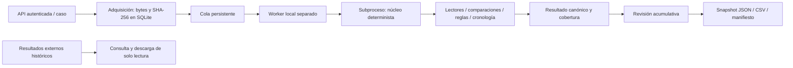

# Motor Forense Móvil de OPERIA — 0.4.0

Nombre funcional provisional. Implementación propia para análisis posterior a una
adquisición autorizada. Sin adquisición directa, explotación, remediación ni IA.

SQLite se deserializa desde bytes preservados en una conexión privada en memoria.
No se abre la adquisición como base de datos ni se ejecutan consultas del cliente.
Consultas fijas, autorizador, configuración defensiva, cuotas y controles del SO
limitan los [perfiles Manifest.db/catálogo](E6_MANIFEST_SQLITE.md).

Los [conjuntos WAL/SHM](E6_WAL_SHM.md) preservan componentes y hashes en una sola
adquisición por expediente. Reconstrucción en memoria hasta el último commit,
procedencia de la imagen derivada y contrastación acotada de SHM antes de usar
esos mismos lectores; sin rutas o consultas recibidas del cliente.

Código real:
- `operia/forensic_engine`: contratos, lectura acotada, normalización/comparación,
  reglas originales de demostración, cronología y salida canónica. Solo stdlib.
- `operia/forensic_jobs`: persistencia SQLAlchemy, cuota lógica, lock de worker,
  estados, cancelación, timeout, recuperación y protocolo privado por stdin/stdout.
- `operia/mobile_forensics/native_router.py`: identidad, ámbito, recepción,
  revisión y exportación. Reutiliza dispositivos existentes sin cambiar sus IDs.
- `MobileForensics.tsx`: flujo nuevo e históricos externos separados.

El núcleo funciona con `python -S -m operia.forensic_engine`: no importa FastAPI,
SQLAlchemy, React, IA ni un motor externo. Los adaptadores actuales están en
readers.py; no se crean carpetas vacías para aparentar módulos.

E6 agrega [metadatos de Info.plist y Manifest.plist](E6_BACKUP_METADATA.md),
con lectores propios en `backup_plists.py`; conserva esquema de resultado y lectores previos.
Diseño pendiente: lectores SQLite sobre copias/WAL/SHM, Manifest.db y archivos lógicos de backup iOS,
contenedores de adquisiciones, correlaciones entre fuentes, correlacion avanzada entre fuentes, IA. El sandbox Windows del SO se incorpora en la etapa documentada en
[Pentest local](../LOCAL_PENTEST.md).
El diagrama representa solo el flujo implementado.

## Integración canónica (2026-10-16)

El operador incorpora una revisión específica mediante POST
`/api/mobile-forensics/native/cases/{case_id}/jobs/{job_id}/integrations?review_id=ID`.
Una transacción crea evidencia del original, acto de custodia de incorporación,
informe técnico con sección/versión y vínculo único por revisión. La instantánea
JSON preserva resultado, metadatos y revisión; su SHA-256 y el del original aparecen
en el informe. El original sigue en Acquisition, sin duplicarlo ni convertir el
histórico externo. GET `.../integrations/{id}` descarga la instantánea verificada.

Los consumidores canónicos y sus alias reciben una sesión de organización: las
consultas ORM se limitan por caso, organización y documento padre; las escrituras
validan referencias del caso. Los registros integrados no se editan ni eliminan
por las rutas canónicas o legacy. Otra revisión produce otra incorporación.

## Proyecciones analiticas preservadas

POST `.../native/cases/{case_id}/jobs/{job_id}/projections` recibe incorporacion,
IDs de artefactos revisados, hipotesis profesional, hechos a probar y opcion Geo.
Crea Finding/Hypothesis separados, con referencias a evidencia y revision. Geo
crea analisis y targets solo cuando hay URLs en los artefactos seleccionados;
no hace DNS, HTTP, geolocalizacion, atribucion ni inferencia de fraude. Si no hay
URLs, la opcion Geo se rechaza sin crear registros. Estado no_evaluado, coordenadas
NULL, score/probabilidades sin evaluacion. Los ceros son valores de esquema, no una
estimacion de riesgo o ausencia de actividad.

AnalysisProjection vincula IDs de destino y conserva snapshot con hash; una misma
solicitud canonica por incorporacion es idempotente. Otra hipotesis/seleccion crea
nuevos registros. Finding/Hypothesis/Geo y sus targets quedan preservados. Las
hipotesis siguen abiertas y requieren corroboracion independiente. GET
`.../projections/{id}` permite descargar el respaldo exacto y la UI muestra IDs.
