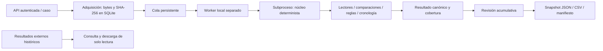

# Motor Forense Móvil de OPERIA — 0.1.0

Nombre funcional provisional. Implementación propia para análisis posterior a una
adquisición autorizada. Sin adquisición directa, explotación, remediación ni IA.

Código real:
- `operia/forensic_engine`: contratos, lectura acotada, normalización/comparación,
  reglas originales de demostración, cronología y salida canónica. Solo stdlib.
- `operia/forensic_jobs`: persistencia SQLAlchemy, cuota lógica, lock de worker,
  estados, cancelación, timeout, recuperación y protocolo privado por stdin/stdout.
- `operia/mobile_forensics/native_router.py`: identidad, ámbito, recepción,
  revisión y exportación. Reutiliza dispositivos existentes sin cambiar sus IDs.
- `MobileForensics.tsx`: flujo nuevo e históricos externos separados.

El núcleo funciona con `python -S -m operia.forensic_engine`: no importa FastAPI,
SQLAlchemy, React, IA ni un motor externo. Los adaptadores actuales están en
readers.py; no se crean carpetas vacías para aparentar módulos.

Diseño pendiente: lectores SQLite sobre copias/WAL/SHM, manifiesto de backup iOS,
contenedores de adquisiciones, correlaciones entre fuentes, conectores seguros a hallazgos/trazado, IA y sandbox del SO.
El diagrama representa solo el flujo implementado.

## Integración canónica (2026-10-16)

El operador incorpora una revisión específica mediante POST
`/api/mobile-forensics/native/cases/{case_id}/jobs/{job_id}/integrations?review_id=ID`.
Una transacción crea evidencia del original, acto de custodia de incorporación,
informe técnico con sección/versión y vínculo único por revisión. La instantánea
JSON preserva resultado, metadatos y revisión; su SHA-256 y el del original aparecen
en el informe. El original sigue en Acquisition, sin duplicarlo ni convertir el
histórico externo. GET `.../integrations/{id}` descarga la instantánea verificada.

Los consumidores canónicos y sus alias reciben una sesión de organización: las
consultas ORM se limitan por caso, organización y documento padre; las escrituras
validan referencias del caso. Los registros integrados no se editan ni eliminan
por las rutas canónicas o legacy. Otra revisión produce otra incorporación.
