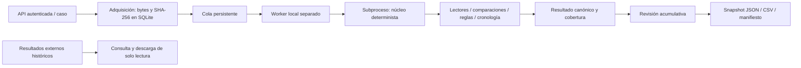

# Motor Forense Móvil de OPERIA — 0.1.0

Nombre funcional provisional. Implementación propia para análisis posterior a una
adquisición autorizada. Sin adquisición directa, explotación, remediación ni IA.

Código real:
- `operia/forensic_engine`: contratos, lectura acotada, normalización/comparación,
  reglas originales de demostración, cronología y salida canónica. Solo stdlib.
- `operia/forensic_jobs`: persistencia SQLAlchemy, cuota lógica, lock de worker,
  estados, cancelación, timeout, recuperación y protocolo privado por stdin/stdout.
- `operia/mobile_forensics/native_router.py`: identidad, ámbito, recepción,
  revisión y exportación. Reutiliza dispositivos existentes sin cambiar sus IDs.
- `MobileForensics.tsx`: flujo nuevo e históricos externos separados.

El núcleo funciona con `python -S -m operia.forensic_engine`: no importa FastAPI,
SQLAlchemy, React, IA ni un motor externo. Los adaptadores actuales están en
readers.py; no se crean carpetas vacías para aparentar módulos.

Diseño pendiente: lectores SQLite sobre copias/WAL/SHM, manifiesto de backup iOS,
contenedores de adquisiciones, correlaciones entre fuentes, conectores seguros a
evidencia/custodia/hallazgos/trazado e informes canónicos, IA y sandbox del SO.
El diagrama representa solo el flujo implementado.
